# Forge

**사내 구성원이 자연어로 요청하면 AI 에이전트가 격리된 샌드박스에서 서비스를 만들고, 자동 정책 검사와 승인을 거쳐 실제로 배포, 운영까지 할 수 있는 사내 개발 플랫폼.**

사내 구성원이 "이런 사내 도구가 필요하다"고 말하면, 일회성 프로토타입이 아니라 **소유자가 있고 운영되는 서비스**가 나옵니다. 
프로젝트의 초점은 **LLM이 만든 검증되지 않은 코드를 어디서, 어떤 권한으로 실행하고, 무엇을 거쳐야 운영에 올라가는가**를 설계하는 데 있습니다.

---

## 주요 기능

| 영역 | 내용 |
|---|---|
| **요청과 빌드** | 자연어 요청을 받아 빌드 큐에 등록하고, 워커가 일회용 샌드박스에서 에이전트(Claude 또는 OpenAI SDK)를 실행 |
| **프리뷰** | 빌드가 만든 이미지 그대로 TTL 프리뷰 컨테이너를 띄우고 서명된 만료 링크로 공유 |
| **정책 게이트** | 6개 정적 검사(비밀/개인정보, 의존성 취약점, egress, 리소스 상한, 템플릿 준수, 파괴적 DDL)와 위험 등급별 승인 라우팅. 검사를 실행할 수 없으면 실패 처리(fail-closed) |
| **승인** | 위험 범위를 분류해 저위험은 자동 승인, 그 외에는 사람 승인. 자기 승인 금지, 승인 수는 서로 다른 승인자 수로 DB에서 강제 |
| **배포·롤백** | 헬스 체크를 통과한 뒤에만 Traefik 트래픽 전환. 롤백은 이전 이미지로 런타임만 되돌림 |
| **데이터** | 서비스마다 개별 DB(공유 Postgres 안의 전용 DB와 롤), 전용 Redis. 마이그레이션은 forward-only, 정기 덤프 |
| **수정** | 배포된 서비스를 자연어로 다시 수정. 코드 수준만 가능하고 스키마 변경은 거절 |
| **비용** | LLM 프록시가 측정한 값만 비용으로 기록. 빌드별 예산, 월 쿼터(경고), 관리자 비용 대시보드 |
| **운영** | 장기 미사용 서비스는 자동으로 중지·보관하고, 데이터 삭제는 관리자만 가능. 라벨 기반 reconciler가 Docker와 DB 상태 차이를 복구 |
| **인증·권한** | `oidc` / `local`(가입 요청 → 관리자 승인) / `dev` 모드. 전역 역할 2단계와 프로젝트 소유권 |
| **자가 수정** | 빌드가 통과했어도 프리뷰 점검에서 500 이상으로 응답하는 경로가 측정되거나 PostgreSQL 파서로 검사해 문법 오류가 확인되면 에이전트가 출력을 한 번 수정. 시도는 타임라인과 승인 콘솔에 표시 |
| **관리자 콘솔** | 역할, 템플릿, 사용량·비용, 배포 상태, eval, 에이전트 엔진 선택, 설정 조회, 가입 요청 |

---

## 화면

> 개발 전용 데모 데이터로 채운 화면입니다. 이름과 링크는 모두 가상입니다.

| 프로젝트 상세 (배포 탭) | 승인 콘솔 |
|---|---|
| 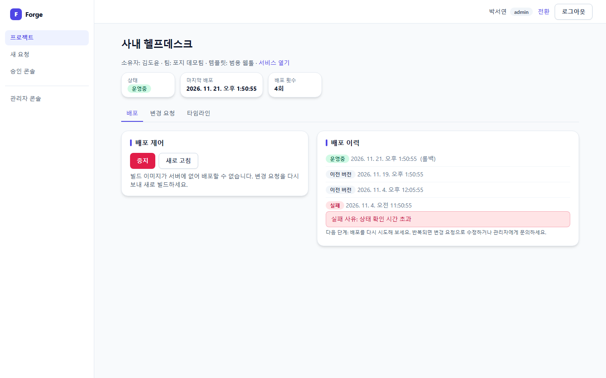 | 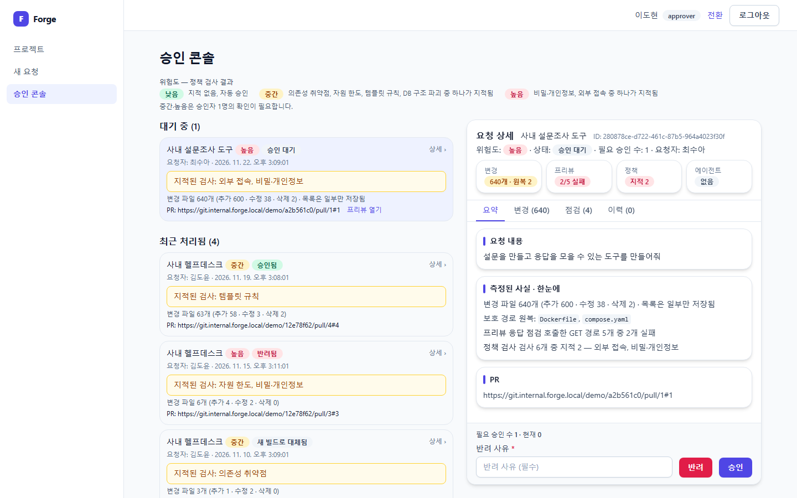 |
| **관리자: 사용량 · 비용** | **관리자: 배포 상태** |
| 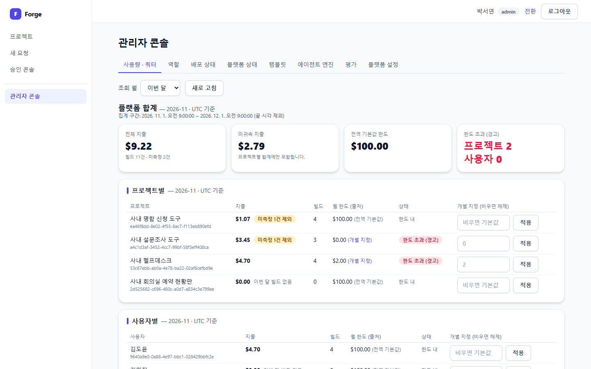 | 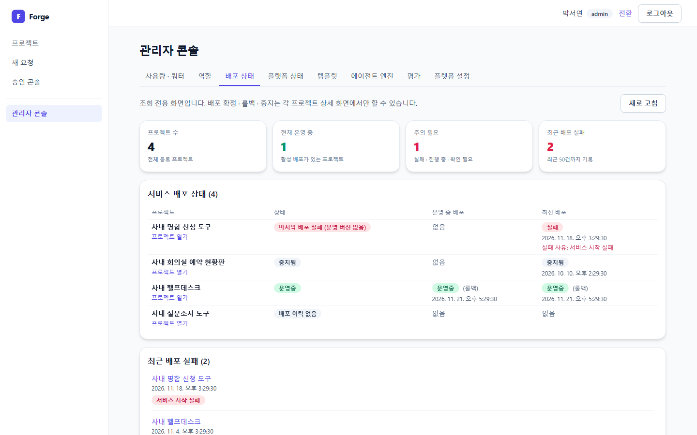 |

<details>
<summary>다른 화면 보기</summary>

| 프로젝트 레지스트리 | 프로젝트 상세 (타임라인 탭) |
|---|---|
| 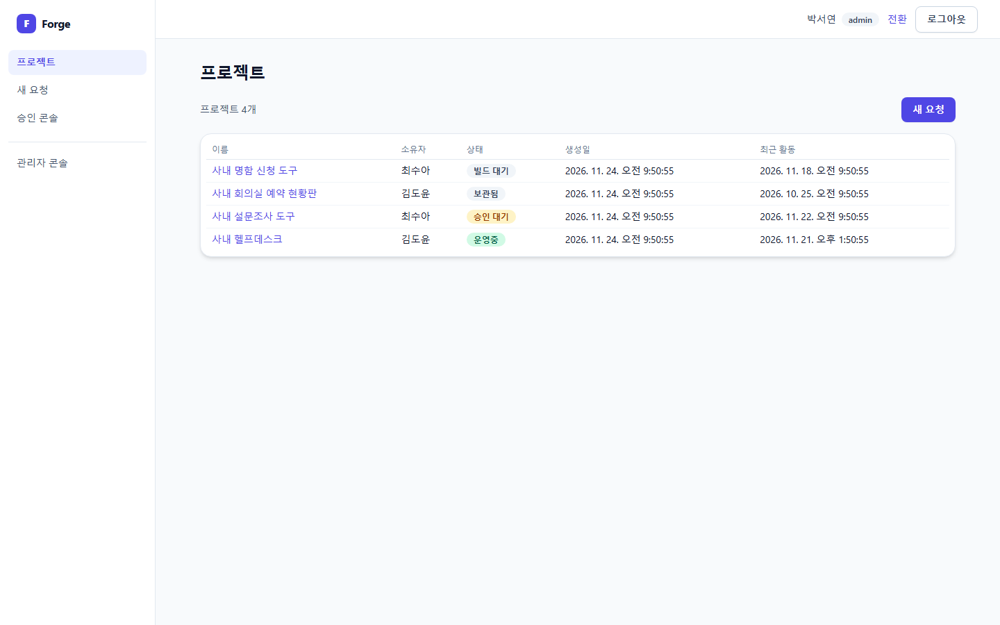 | 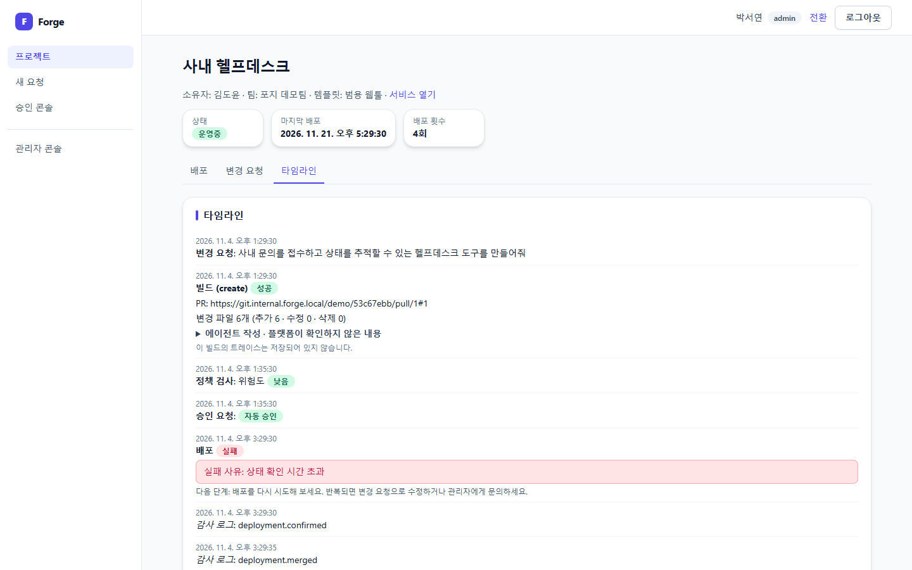 |
| **새 요청** | **관리자: 평가(eval) 실행** |
| 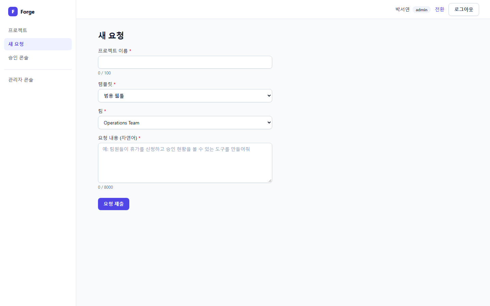 | 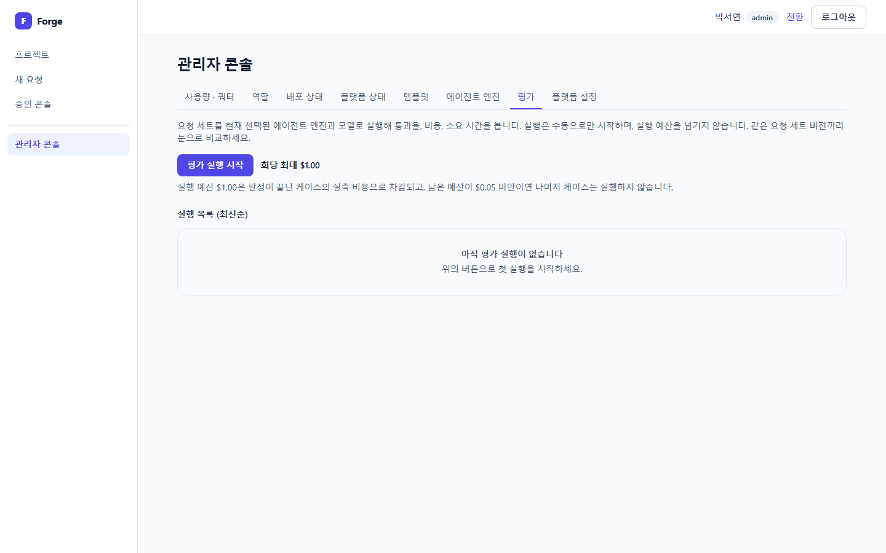 |

</details>

---

## 아키텍처

단일 Linux 호스트의 Docker 위에서 동작하고, 네 개의 신뢰 영역으로 나뉩니다. 가장 중요한 경계는 **L3(검증되지 않은 LLM 코드가 실행되는 곳)와 L4(사람이 확인한 컨테이너만 실행되는 곳)** 사이입니다.

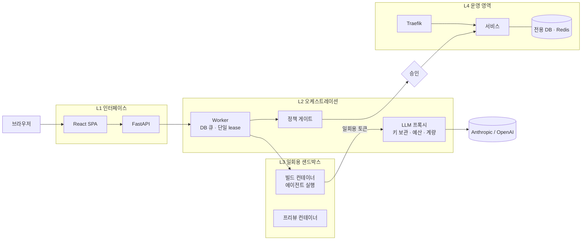

**요청 한 건의 흐름:** 요청 → `QUEUED` → 워커가 샌드박스 생성 → 에이전트 실행 → 결과물 회수(harvest)와 정제 복사 → 이미지 조립 → 프리뷰 → 정책 게이트 → 자동 또는 사람 승인 → 헬스 체크 후 트래픽 전환 → 운영

### 경계와 요청 흐름

L3의 코드는 L4로 직접 갈 수 없습니다. L2가 샌드박스에 작업을 넣고(투입) 결과를 꺼내며(회수), 운영으로는 정책 게이트를 통과하고 소유자가 확인한 이미지만 올라갑니다.

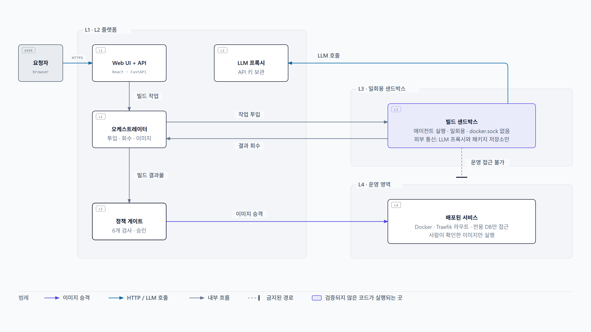

아래는 요청 한 건이 지나는 경로입니다. 정책 게이트에서 걸린 빌드만 승인자 검토를 거치고, 깨끗한 빌드는 바로 소유자 확인으로 넘어갑니다.

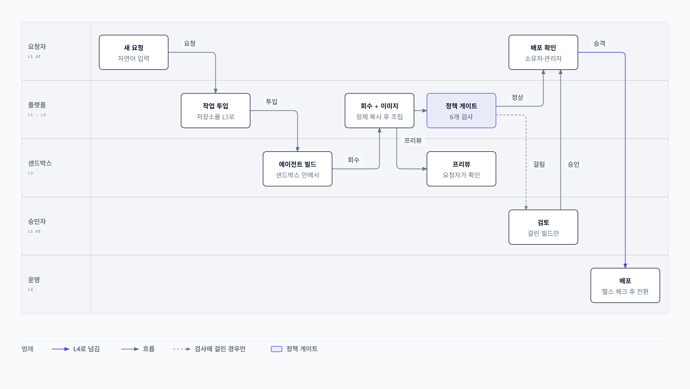

---

## 보안 설계

보안은 에이전트 엔진이 아니라 **샌드박스와 정책 계층**이 책임집니다. 엔진은 교체 가능한 부품입니다.

| 위협 | 대응 |
|---|---|
| 생성 코드가 샌드박스를 탈출해 호스트에 접근 | 빌드마다 일회용 컨테이너 생성. Docker 소켓과 호스트 마운트 없음(파일은 tar로만 전달), `cap_drop=ALL`(작업 공간 준비용 `CHOWN`만 추가), `no-new-privileges`. 에이전트와 빌드 명령은 nobody 사용자로 실행 |
| 생성 코드의 자원 고갈 | 메모리·CPU·PID·디스크 상한과 빌드 시간 제한. 결과물 회수(harvest)도 용량과 항목 수에 상한이 있어, 한도를 넘으면 빌드가 `RESOURCE_LIMIT`으로 실패하고 워커와 다른 빌드는 영향받지 않음 |
| 생성 코드가 운영 환경(L4)에 직접 접근 | 빌드별 internal 네트워크라 L4로 가는 경로가 없음. 운영에는 정책 게이트를 통과하고 소유자가 확인한 이미지만 올라감 |
| 에이전트가 API 키 탈취 | 진짜 키는 L2 프록시에만 있음. 샌드박스는 빌드마다 발급되고 종료 시 폐기되는 프록시 토큰만 받음 |
| 제공사 측 도구(웹 검색, MCP)를 통한 유출·주입 | 프록시가 요청을 **허용 목록**으로 검사하고 서버 측 도구를 거절. 워크스페이스의 엔진 설정 파일은 로드하지 않음. SDK/CLI 버전 고정 |
| 비용 폭주, 조작된 비용 보고 | 비용은 프록시가 측정한 값만 사용(SSE·캐시 토큰 포함). 토큰당 호출 직렬화로 동시 요청 우회 차단. 측정 불가 시 fail-closed |
| 회수한 결과물이 호스트 도구를 공격(`.git/hooks` 등) | 새 디렉터리로 정제 복사. 모든 깊이의 `.git`과 플랫폼 채널은 제외하고, 링크·장치 파일이 있으면 빌드 거절 |
| secret 노출 | 서비스 env는 Fernet으로 at-rest 암호화. 설정의 비밀 필드는 `repr`·로그·검증 오류에 노출하지 않음 |

**정책 검사의 수준.** 6개 검사는 모두 회수한 워크스페이스에 대한 정적 휴리스틱이며, 격리 수단이 아닙니다. 실제 방어선은 샌드박스와 네트워크 차단입니다.
- 의존성 취약점 검사는 오프라인 취약 버전 표만 확인합니다. 실시간 취약점 DB에 접근할 수 없으므로, 의존성 매니페스트(`requirements.txt` 등)가 있는 빌드는 항상 지적되어 사람 승인으로 넘어갑니다(fail-closed).
- egress 검사는 소스의 외부 호출 패턴을 정규식으로 찾습니다. 우회가 가능하다는 전제로 둔 보조 신호입니다.
- 검사는 diff가 아니라 워크스페이스 전체를 보므로, 이미 승인된 항목이 다음 빌드에서 다시 지적될 수 있습니다.

**설계 결정 기록.** 위 대응이 왜 그렇게 정해졌는지, 어떤 대안을 왜 버렸는지는 [`docs/decisions/`](docs/decisions/README.md)에 ADR로 남겼습니다.

---

## 기술 스택

- **백엔드:** Python, FastAPI, SQLAlchemy, Alembic, Docker SDK, httpx, Fernet(cryptography), PyJWT(OIDC)
- **프론트엔드:** React 18, TypeScript, Vite, react-router, Tailwind CSS v4, Vitest, Testing Library
- **런타임:** Docker, Traefik v3.6.1 이상, PostgreSQL, Redis
- **에이전트:** Claude Agent SDK, OpenAI Agents SDK
- **생성되는 서비스 템플릿:** FastAPI + PostgreSQL + Redis

---

## 프로젝트 구조

```
├── backend/
│   ├── app/
│   │   ├── main.py, config.py, worker.py, proxy_server.py
│   │   ├── routers/      프로젝트, 빌드, 배포, 승인, 인증, 관리자 콘솔, eval, 사용량
│   │   ├── services/     샌드박스 실행, LLM 프록시, 정책 게이트, 배포, 프리뷰 등
│   │   ├── models/       SQLAlchemy 테이블 (프로젝트, 빌드, 배포, 승인, 정책 판정, 감사 등)
│   │   └── schemas/      API 요청·응답 Pydantic 스키마
│   ├── migrations/       Alembic
│   ├── templates/generic-webtool/   생성 서비스의 골든 패스 템플릿
│   ├── docker/           agent-sandbox, agent-sandbox-openai, agent-sandbox-stub, llm-proxy
│   ├── evals/            eval 요청 세트
│   └── tests/
├── frontend/src/         페이지(요청, 프로젝트, 승인 콘솔, 관리자 콘솔), 컴포넌트, 테스트
├── docs/decisions/       설계 결정 기록(ADR)
└── dev.ps1, test.ps1, forge.bat   로컬 실행, 테스트 스크립트와 메뉴
```

---

## 로컬 실행 (Windows)

**준비물:** Python 3.11 이상, Node 22, Docker Desktop, PowerShell

```powershell
.\dev.ps1
```

`dev.ps1`이 하는 일:
1. `backend\.venv`를 만들고 고정된 의존성(`constraints.txt`)을 설치
2. `.env`가 없으면 `.env.example`을 복사 (`FORGE_ENV=dev` 등 개발 기본값 포함)
3. 서비스용 Postgres 컨테이너를 `127.0.0.1:55432`에 띄우고 관리자 DSN을 `.env`에 기록
4. `alembic upgrade head` (DB가 head가 아니면 서버와 워커는 시작 거부)
5. 백엔드(`:8000`), 프론트엔드(`:5173`), 빌드를 처리하는 워커 실행 (로그: `backend\worker.log`, `backend\worker.err.log`)

워커가 없으면 새 요청이 `QUEUED`에 머뭅니다. 화면만 볼 때나 워커를 다른 터미널에서 직접 돌릴 때는 `.\dev.ps1 -NoWorker`로 워커를 빼고 실행하세요. 워커만 따로 실행하려면:

```powershell
cd backend
.venv\Scripts\python -m app.worker
```

`forge.bat`을 실행하면 같은 동작(개발 서버, 워커만, 테스트, 데모 데이터, 이미지 빌드)을 번호 메뉴로 고를 수 있습니다.

API와 워커는 서로 다른 프로세스이므로, 프리뷰 링크가 동작하려면 `backend\.env`에 `PREVIEW_SIGNING_SECRET`(32바이트 이상)을 설정하세요.

**실제 에이전트 빌드:** `.env`에 `USE_SANDBOX_EXECUTOR=true`와 `ANTHROPIC_API_KEY` 또는 `OPENAI_API_KEY`를 설정하고, 샌드박스와 프록시 이미지를 빌드합니다. 설정하지 않으면 실제 LLM을 호출하지 않는 대체 실행기로 동작합니다.

```bash
cd backend
docker build -t forge-llm-proxy:latest -f docker/llm-proxy/Dockerfile .
# Claude 엔진
docker build -t forge-agent-sandbox:latest docker/agent-sandbox
# OpenAI 엔진
docker build -t forge-agent-sandbox-openai:latest -f docker/agent-sandbox-openai/Dockerfile .
```

**화면만 둘러보기:** 실제 빌드 없이 화면을 채우려면 개발 전용 데모 데이터를 넣을 수 있습니다(`AUTH_MODE=dev`에서 사용자 전환으로 역할별 화면 확인).

```powershell
cd backend
.venv\Scripts\python -m app.demo_data
```

> 개발 스크립트는 Windows 기준. 플랫폼이 목표로 하는 운영 환경은 단일 Linux 호스트이며, CI는 Ubuntu에서 전체 테스트를 실행

모든 설정은 [`backend/.env.example`](backend/.env.example)에 설명되어 있습니다(한글판: [`backend/.env.example.ko`](backend/.env.example.ko)).

---

## 테스트와 CI

```powershell
.\test.ps1            # 전체
.\test.ps1 backend    # pytest
.\test.ps1 frontend   # tsc -b + vitest
```

- **백엔드:** 테스트 파일 202개, 테스트 케이스 5,359개(파라미터 포함). 그중 실제 Docker, Traefik, Postgres, Redis를 쓰는 통합 테스트 279개는 Docker가 없으면 skip되고, 나머지는 Docker 없이 실행
- **프론트엔드:** Vitest 테스트 1,420개(파일 82개, 접근성 테스트 포함), `tsc -b` 무결
- **검증 방식:** 결함을 일부러 심어(mutation) 테스트가 실제로 실패하는지 확인
- **CI (GitHub Actions):**
  - `ci.yml`: 고정된 의존성으로 백엔드 전체 테스트(Docker 이미지 빌드 포함), 프론트엔드 타입 검사, 테스트, 빌드
  - `backend-drift.yml`: 매주 최신 의존성으로 테스트하는 비차단 job
- 모델과 마이그레이션이 일치하는지, 새 설정이 `.env.example`과 한글판에 함께 들어갔는지도 테스트로 확인

---

## 실제 실행 결과

- 회의실 예약 목록(`start`·`end` 시각 컬럼이 필요한 요청) 생성으로 테스트 진행
- **첫 실제 빌드:** OpenAI `gpt-5-mini`, 43초, 비용 $0.0044, 배포까지 성공
- **같은 요청 20회 반복:** 결과 검증을 위해 `gpt-5-mini`로 자가 수정 끔 10회, 켬 10회 실행(비용 합계 $0.37). 빌드 20건은 모두 성공했지만, 프리뷰 응답 점검의 `GET /bookings` 결과에서는 실패 발생

  | | 자가 수정 끔 | 자가 수정 켬 |
  |---|---|---|
  | 첫 시도에서 500 | 4/10 | 2/10 |
  | 출고된 빌드에서 500 | 4/10 | 0/10 |
  | 수리된 빌드 | 0 | 2 |

  **같은 요청 20회 중 6회(30%)의 첫 시도에서 500을 냈습니다.** 빌드는 모두 "성공"이었고, 결함은 프리뷰를 실제로 호출해야 보였습니다. 코드를 읽어보니 6건은 모두 SQL 문자열에서 PostgreSQL 예약어 `end`를 따옴표 없이 썼습니다.

---

## 알려진 한계와 다음 단계

- 단일 호스트 구조라 플랫폼 제어판이 뚫리면 호스트 전체가 위험합니다. 수십~수백 명의 사내 구성원 대상이라 의도적으로 받아들인 위험입니다.
- 빌드와 프리뷰의 런타임은 gVisor(`runsc`)로 바꿀 수 있고 WSL2에서 측정했지만, 기본값은 runc입니다. 프리뷰와 배포 컨테이너는 non-root로 실행합니다. ([ADR 0046](docs/decisions/0046-gvisor-for-build-and-preview.md))
- 서비스 비밀 값(서비스 DB 비밀번호 등)을 바꾸는 회전은 설계(운영자가 실행하고, 배포의 헬스 체크 전환을 재사용)만 있고 구현은 아직입니다. 저장용 암호화 키의 회전은 구현되어 있습니다.
- TLS 인증서 발급 방식은 배포할 때 정합니다. 개발 환경의 기본은 평문이고, prod에서는 플랫폼의 공개 origin이 https여야 시작됩니다.
- 다음 후보: 사내 도구 레지스트리(MCP 허브), 두 번째 템플릿(AI 에이전트 웹 도구), Prometheus/Grafana 연동
